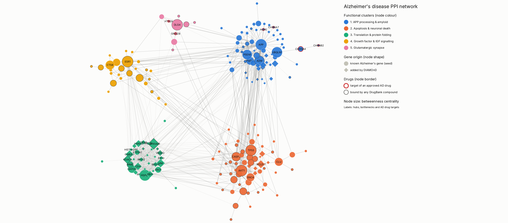
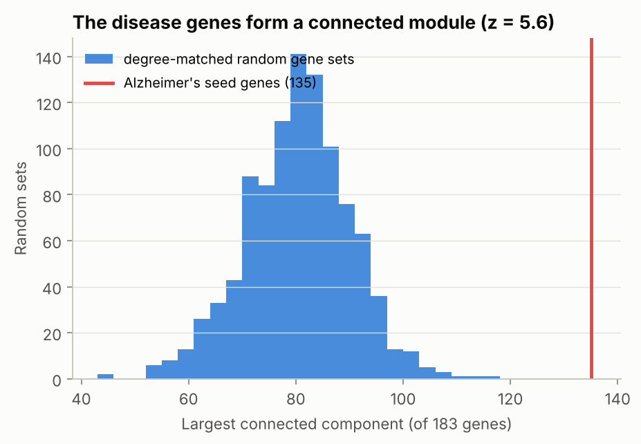
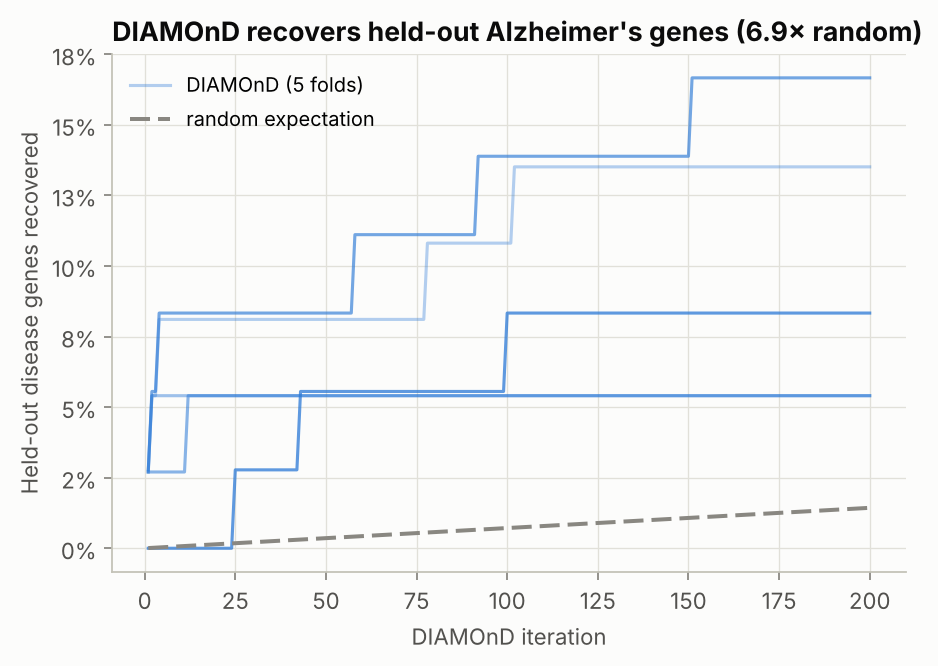
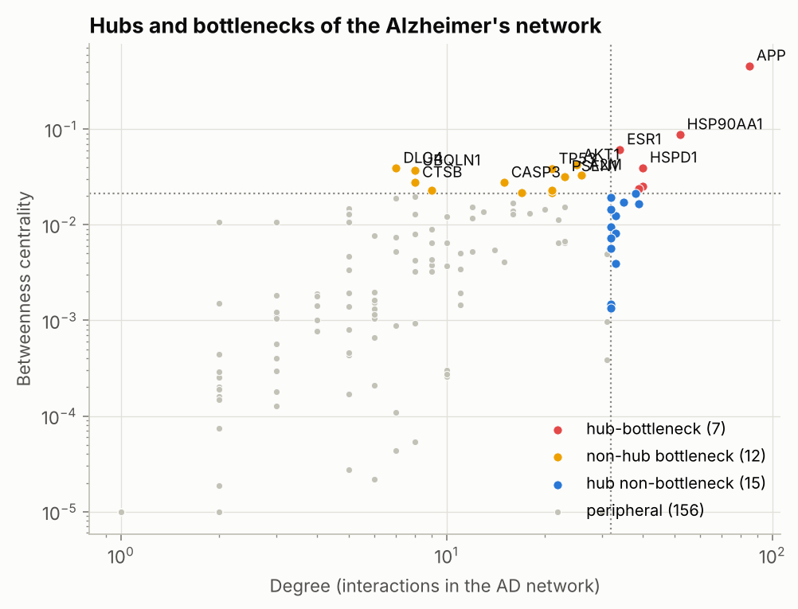
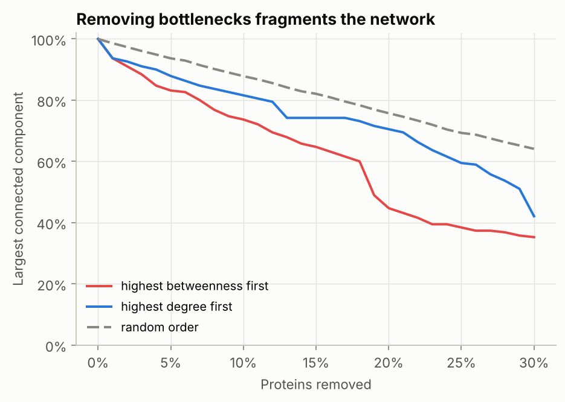
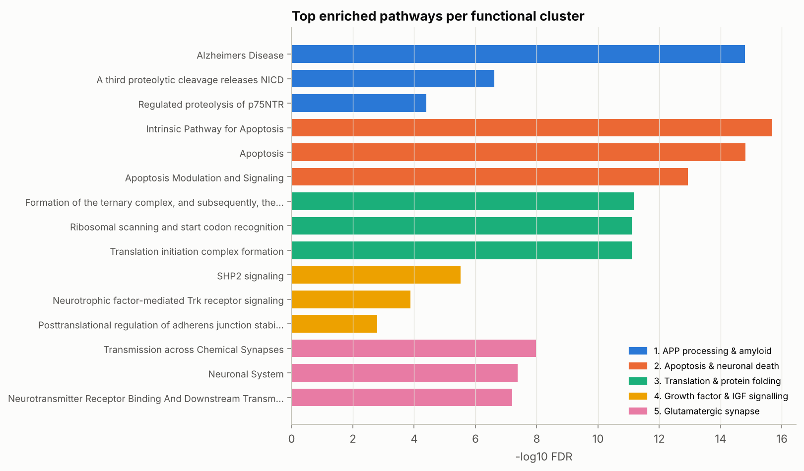
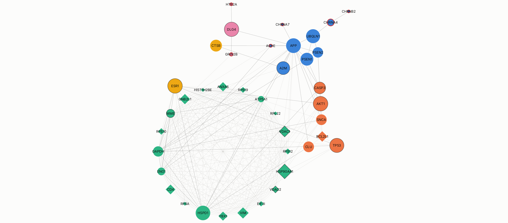
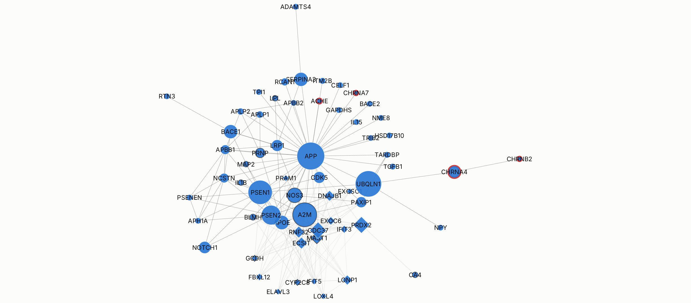
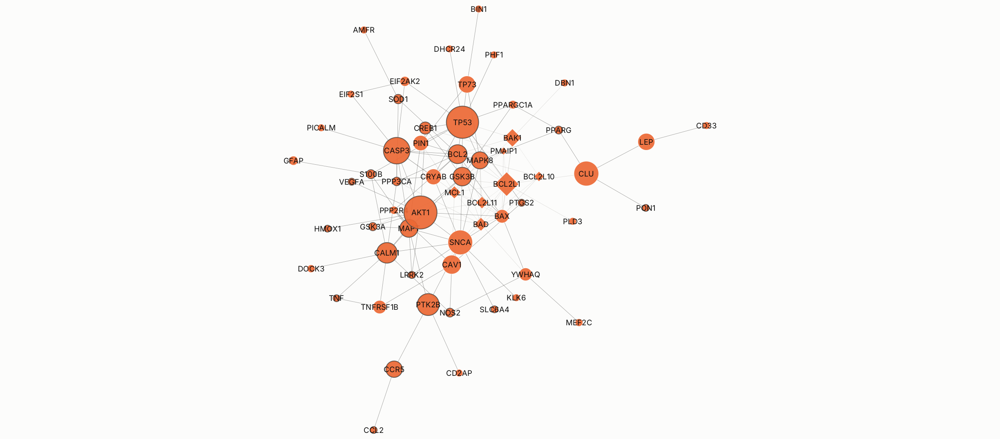
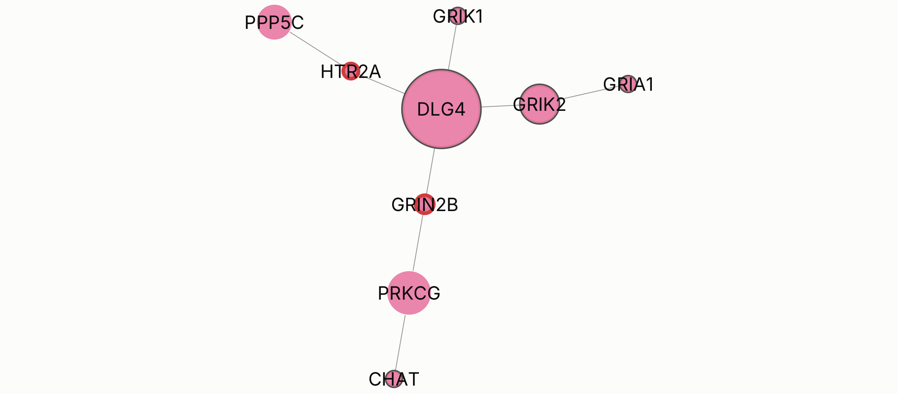

# PPI Network Analysis with Cytoscape: Alzheimer's Disease

[](https://github.com/Raghayev17889/PPI_network_analysis_with_cytoscape/actions/workflows/ci.yml)


This project builds, filters, analyses and visually styles a disease-related protein-protein interaction (PPI)
network for **Alzheimer's disease (AD)**, using real data and network-medicine methods. The visualisation
is automated in **Cytoscape** with `py4cytoscape`. The pipeline identifies the proteins that hold the disease
network together (hubs and bottlenecks), finds its functional clusters, and shows where current AD drugs act.

<p align="center">
  
</p>

*The Alzheimer's disease network rendered by Cytoscape 3.10 through py4cytoscape. Colour = functional cluster,
shape = known AD gene (circle) or DIAMOnD-predicted module gene (diamond), size = betweenness centrality, red ring =
target of an approved AD drug. Also available as [SVG](cytoscape/figures/alzheimer_network.svg),
[PDF](cytoscape/figures/alzheimer_network.pdf) and a [Cytoscape session](cytoscape/alzheimer_network.cys).*

## Key findings

1. **AD genes form a disease module.** 135 of the 183 AD-associated proteins found in the interactome form one
   connected component. Degree-matched random gene sets reach about 80 (z = 5.6, empirical p < 0.001).
2. **The module can be extended reliably.** DIAMOnD recovers held-out AD genes at **6.9× the random rate** in
   five-fold cross-validation (18 recovered vs 2.6 expected).
3. **APP is the main bottleneck.** Almost half of all shortest paths in the network (betweenness 0.46) run
   through the amyloid precursor protein. The other key proteins are HSP90AA1, ESR1 and HSPD1
   (hub-bottlenecks), and AKT1, TP53, PSEN1, A2M, CASP3, CLU and DLG4 (non-hub bottlenecks). Removing the top 10%
   of bottlenecks shrinks the network's largest component to 74%, against 88% for random removal.
4. **Five functional clusters** (Louvain, modularity 0.47) correspond to the main hypotheses of AD
   pathogenesis: APP processing and amyloid, apoptosis and neuronal death, translation and protein folding,
   growth-factor and IGF signalling, and the glutamatergic synapse.
5. **Approved AD drugs act at the periphery.** All six targets of donepezil, galantamine, rivastigmine and
   memantine that are in the network (ACHE, CHRNA4, CHRNA7, CHRNB2, GRIN2B, HTR2A) have 1-3 interactions. The
   central proteins are different, and 29% of them are bound by some DrugBank compound. These are candidates for
   network-based repurposing, not recommendations.

## Data

All data comes from **[Hetionet v1.0](https://het.io)** (Himmelstein et al., *eLife* 2017; CC0), downloaded from
a pinned commit of [hetio/hetionet](https://github.com/hetio/hetionet) and verified by SHA-256:

| component | Hetionet edges | source databases | used for |
|---|---|---|---|
| human interactome | `GiG`, 147,164 interactions | HI-II-14, Menche et al. 2015 interactome and others | network backbone |
| AD-associated genes | `DaG`, 196 genes | GWAS Catalog, DISEASES, DisGeNET, DOAF | seed genes |
| AD up/down-regulated genes | `DuG` / `DdG` | STARGEO | node annotation |
| pathways | `GpPW`, 1,822 sets | Reactome, WikiPathways, PID (Pathway Commons) | cluster enrichment |
| GO biological processes | `GpBP`, 11,381 sets | Gene Ontology | cluster enrichment |
| approved AD drugs and targets | `CtD`, `CbG` | DrugBank | drug-target annotation |

`python src/hetionet.py` downloads the files (about 15 MB) into `data/raw/` and caches the AD tables in
`data/processed/` (both git-ignored).

## Methods

```
Hetionet ─► interactome ─► disease module test ─► DIAMOnD expansion ─► filtering ─► AD network
(download,   (no ubiquitin,   (LCC vs 1,000 degree-    (+ 5-fold CV)        (seeds + top 50,     │
 checksum)    LCC)             matched random sets)                          induced subgraph,   │
                                                                             LCC)                │
     ┌────────────────────────────────────┬──────────────────────────────────────┬───────────────┘
     ▼                                    ▼                                      ▼
hubs & bottlenecks + robustness   Louvain clusters + stability   pathway / GO enrichment (BH-FDR)
     └────────────────────────────────────┴──────────────► Cytoscape (py4cytoscape): style, layout,
                                                           legend, subnetworks, images, .cys session
```

| step | method | module |
|---|---|---|
| Interactome | Hetionet GiG. The four ubiquitin genes are excluded (UBC alone has 8,611 partners from ubiquitination proteomics), and only the largest component is kept: 14,108 proteins, 137,912 interactions | `src/interactome.py` |
| Disease module | Size of the seed genes' largest connected component vs 1,000 degree-matched random sets (Menche et al., 2015) | `src/disease_module.py` |
| Module expansion | DIAMOnD (Ghiassian et al., 2015) with exact log-space hypergeometric p-values, validated by five-fold recovery of held-out seeds | `src/diamond.py` |
| Filtering | 196 seeds → 183 in interactome → + 50 DIAMOnD → induced subgraph → largest component: **190 proteins, 1,085 interactions** | `src/disease_network.py` |
| Hubs and bottlenecks | Degree and betweenness (top 10% each; Yu et al., 2007), plus closeness, eigenvector, clustering and k-core; targeted vs random removal | `src/topology.py` |
| Functional clusters | Louvain (Blondel et al., 2008), reproducible across processes; stability by adjusted Rand index over 20 reruns | `src/clustering.py` |
| Enrichment | Hypergeometric test against the interactome background, Benjamini-Hochberg FDR | `src/enrichment.py` |
| Visualisation | py4cytoscape: CyREST style JSON, deterministic cluster layout, annotation legend, cluster and key-protein subnetworks, PNG/SVG/PDF export, `.cys` session, style XML | `src/cytoscape_viz.py` |

## Results

| | |
|:---:|:---:|
|  |  |
|  |  |

**Top bottlenecks** (`results/tables/key_proteins.tsv`):

| protein | role | class | degree | betweenness | cluster |
|---|---|---|---:|---:|---|
| APP | seed | hub-bottleneck | 85 | 0.457 | APP processing & amyloid |
| HSP90AA1 | DIAMOnD | hub-bottleneck | 52 | 0.087 | Translation & protein folding |
| ESR1 | seed | hub-bottleneck | 34 | 0.061 | Growth factor & IGF signalling |
| AKT1 | seed | non-hub bottleneck | 25 | 0.042 | Apoptosis & neuronal death |
| HSPD1 | seed | hub-bottleneck | 40 | 0.039 | Translation & protein folding |
| DLG4 | seed | non-hub bottleneck | 7 | 0.039 | Glutamatergic synapse |
| TP53 | seed | non-hub bottleneck | 21 | 0.038 | Apoptosis & neuronal death |
| UBQLN1 | seed | non-hub bottleneck | 8 | 0.037 | APP processing & amyloid |
| A2M | seed | non-hub bottleneck | 26 | 0.033 | APP processing & amyloid |
| PSEN1 | seed | non-hub bottleneck | 23 | 0.032 | APP processing & amyloid |

**Functional clusters** (`results/tables/clusters.tsv`, `results/tables/cluster_enrichment.tsv`):

| # | cluster | proteins | top enriched pathway (FDR) | key members |
|---|---|---:|---|---|
| 1 | APP processing & amyloid | 62 | Alzheimer's disease, WikiPathways (1.6e-15) | APP, PSEN1/2, NCSTN, APH1A, BACE1, APOE |
| 2 | Apoptosis & neuronal death | 59 | Intrinsic pathway for apoptosis (2.1e-16) | AKT1, TP53, BCL2, CASP3, SNCA, MAPT, GSK3B |
| 3 | Translation & protein folding | 34 | 43S complex formation (6.8e-12) | HSP90AA1, HSPD1, ribosomal proteins, VDAC1-3 |
| 4 | Growth factor & IGF signalling | 26 | SHP2 signalling (3.0e-6) | ESR1, IGF1R, INS, IGF1, IGF2 |
| 5 | Glutamatergic synapse | 9 | Transmission across chemical synapses (1.1e-8) | DLG4, GRIN2B, GRIA1, GRIK1, GRIK2 |

<p align="center">
  
</p>

### Cytoscape views

| hubs, bottlenecks and drug targets | cluster 1: APP processing & amyloid |
|:---:|:---:|
|  |  |
| **cluster 2: apoptosis & neuronal death** | **cluster 5: glutamatergic synapse** |
|  |  |

## Project structure

```
├── config/config.yaml              # every parameter (disease, thresholds, cluster names, Cytoscape URL)
├── src/
│   ├── data_download.py            # pinned, checksum-verified Hetionet download
│   ├── hetionet.py                 # extract disease genes, interactome, gene sets, drugs
│   ├── interactome.py              # interactome graph, ubiquitin exclusion, seed mapping
│   ├── disease_module.py           # LCC significance vs degree-matched random gene sets
│   ├── diamond.py                  # DIAMOnD module expansion + cross-validation
│   ├── disease_network.py          # filtering steps and node annotation
│   ├── topology.py                 # centralities, hub/bottleneck classes, robustness
│   ├── clustering.py               # Louvain clusters and stability
│   ├── enrichment.py               # hypergeometric enrichment, BH-FDR, cluster labels
│   ├── cytoscape_viz.py            # py4cytoscape: style, layout, legend, subnetworks, exports
│   ├── plots.py                    # matplotlib figures
│   └── pipeline.py                 # end-to-end CLI
├── notebooks/
│   ├── 01_data_exploration.ipynb
│   ├── 02_disease_module_and_centrality.ipynb
│   └── 03_cytoscape_visualization.ipynb
├── cytoscape/
│   ├── alzheimer_network.cys       # Cytoscape session (networks, style, layout, legend)
│   ├── styles/                     # style as Cytoscape XML and CyREST JSON
│   ├── network/                    # .cyjs (with positions) and .graphml for import
│   └── figures/                    # PNG / SVG / PDF exports
├── results/
│   ├── tables/                     # rankings, metrics, clusters, enrichment, filtering log
│   ├── figures/
│   └── summary.json
└── tests/                          # pytest suite (no downloads, no Cytoscape needed)
```

## Getting started

```bash
git clone https://github.com/Raghayev17889/PPI_network_analysis_with_cytoscape.git
cd PPI_network_analysis_with_cytoscape
python -m venv venv
source venv/bin/activate          # Windows: venv\Scripts\activate
pip install -r requirements.txt   # + requirements-dev.txt for tests and notebooks
```

1. Install **Cytoscape 3.10+** from <https://cytoscape.org> and open it (CyREST listens on port 1234; no apps
   are needed).
2. Run the full pipeline. It downloads the data, analyses it, and builds and saves the Cytoscape session:

   ```bash
   python src/pipeline.py
   ```

   Without Cytoscape, `python src/pipeline.py --no-cytoscape` still produces all tables and figures, plus
   `cytoscape/network/*.cyjs|.graphml` and the style JSON for later import.
3. Explore the notebooks: `jupyter lab notebooks/`.
4. Open the result in Cytoscape: *File > Open Session* → `cytoscape/alzheimer_network.cys`. To reuse the style on
   another network, use *File > Import > Styles from File* → `cytoscape/styles/alzheimer_style.xml`.

To analyse another disease, change `disease.id` in `config/config.yaml` to any of the 137 Hetionet diseases
(e.g. `DOID:14330` Parkinson's disease, `DOID:1612` breast cancer) and update or remove `cluster_names`.

```bash
pytest          # 45 tests: parsing, DIAMOnD vs brute force, statistics, style, layout, end-to-end
```

## Limitations

* Interactomes are incomplete and biased towards well-studied proteins. The degree-matched null model
  corrects the module test for this, but hub status still partly reflects research attention. For example,
  APP, one of the most studied human proteins, has 1,906 partners in the interactome.
* Seed genes mix GWAS loci with literature associations. Genes without interactions (MS4A4A, MS4A6A, CASS4,
  SLC24A4, ...) cannot be placed in the network.
* Louvain partitions are only moderately stable (mean adjusted Rand index 0.70 over 20 reruns). Cluster cores
  are robust, but borders between the larger clusters are not.
* Hetionet v1.0 dates from 2016-2017. A current interactome (e.g. HuRI, STRING) and gene-disease database would
  add more recent AD loci.

## References

* Himmelstein, D. S. *et al.* Systematic integration of biomedical knowledge prioritizes drugs for repurposing.
  *eLife* 6, e26726 (2017).
* Menche, J. *et al.* Uncovering disease-disease relationships through the incomplete interactome. *Science* 347,
  1257601 (2015).
* Ghiassian, S. D., Menche, J. & Barabási, A.-L. A DIseAse MOdule Detection (DIAMOnD) algorithm derived from a
  systematic analysis of connectivity patterns of disease proteins in the human interactome.
  *PLoS Comput Biol* 11, e1004120 (2015).
* Yu, H. *et al.* The importance of bottlenecks in protein networks: correlation with gene essentiality and
  expression dynamics. *PLoS Comput Biol* 3, e59 (2007).
* Blondel, V. D. *et al.* Fast unfolding of communities in large networks. *J Stat Mech* P10008 (2008).
* Shannon, P. *et al.* Cytoscape: a software environment for integrated models of biomolecular interaction
  networks. *Genome Res* 13, 2498-2504 (2003).
* Otasek, D. *et al.* Cytoscape Automation: empowering workflow-based network analysis. *Genome Biol* 20, 185
  (2019).

## License

Code: MIT (see [LICENSE](LICENSE)). Hetionet is released under CC0; its underlying resources keep their own
licences.
